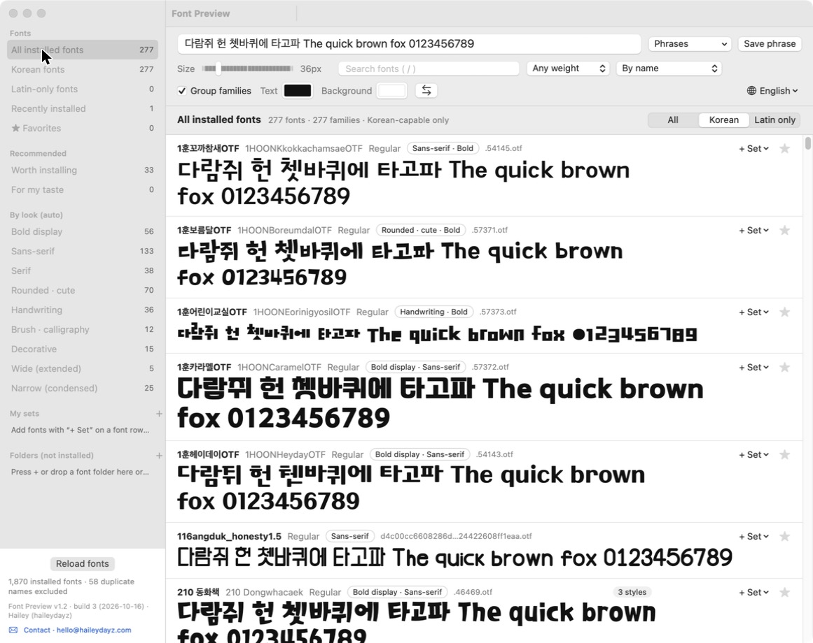
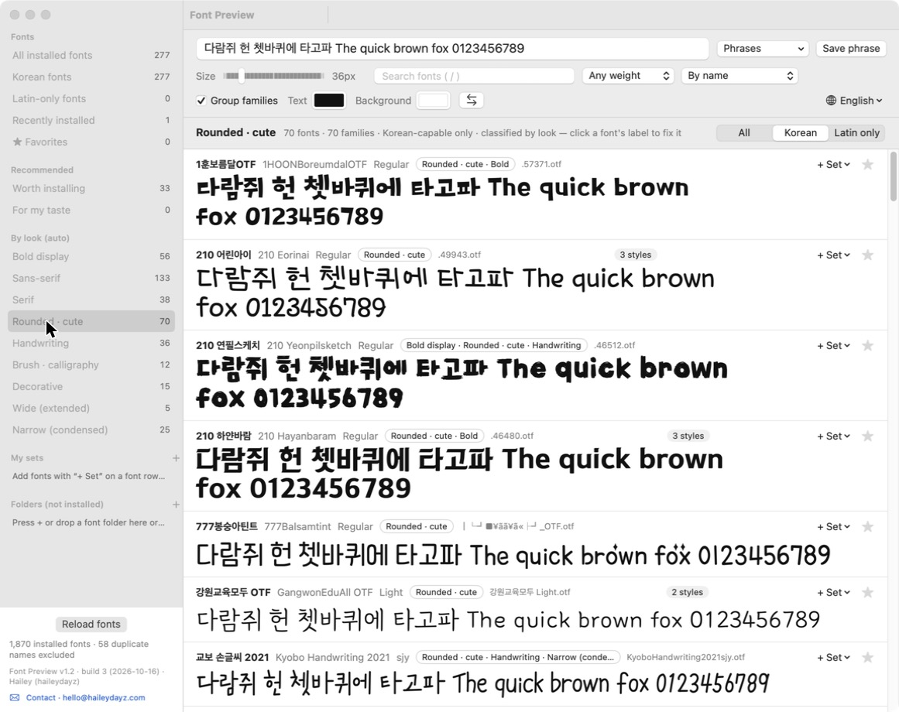
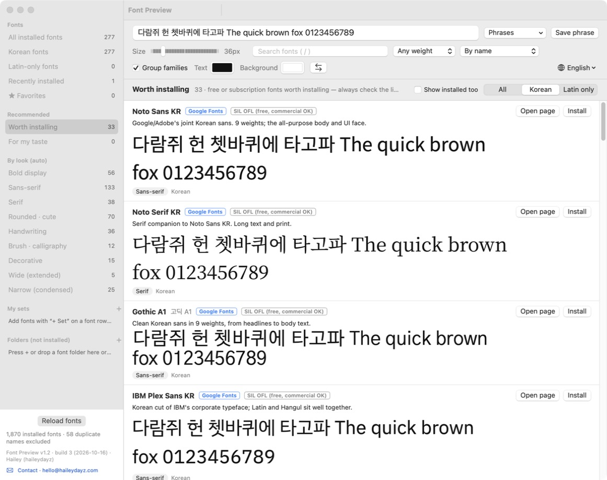

# Font Preview for Mac (폰트 미리보기)

A native macOS font previewer in the spirit of NexusFont on Windows: every installed font (Adobe Fonts included) rendered with the same sample text in one window, **sorted by how fonts look** — bold display, sans, serif, rounded, handwriting, brush, decorative, wide, condensed — plus personal sets, folder previews for fonts you haven't installed, and a curated "worth installing" tab with live previews and one-click install for open-licensed fonts.

**English and Korean UI** — follows your system language, switchable any time from the 🌐 menu (top right) or Help → Language.

## Install

1. Download `FontPreview-<version>.zip` from [Releases](https://github.com/haileydaysincanada-maker/font-preview-mac/releases), unzip, move the app to Applications.
2. First launch: **right-click → Open** (the app is not notarized; macOS shows an "unidentified developer" warning once).
3. macOS 13 Ventura or later. Universal binary (Apple Silicon + Intel).

Or build it yourself with only the Command Line Tools (no Xcode): `native/build.sh` → `폰트 미리보기.app` in about a minute.

## How to use

- **Sample text** at the top; the **Phrases** menu keeps your favorites; **Size** slider, **Text / Background** colors, **Group families** (one row per family, expand with "N styles").
- **Sidebar → Fonts**: all installed, Korean, Latin-only, recently installed (30 days), ★ favorites.
- **Sidebar → By look (auto)**: fonts are classified by rendering a few glyphs and measuring stroke width, serif feet, corner roundness, baseline wobble and aspect ratio (name hints help too). Click a font's label to fix a wrong guess — it is remembered. Brush vs pen handwriting is the weakest guess; fix those by hand.
- **All / Korean / Latin only** toggle (header right) filters whatever you are looking at; fonts without Korean glyphs always show the Latin part of your sample.

- **My sets**: "+ Set" on any font row; rename or delete from the sidebar context menu.
- **Folders (not installed)**: press +, drop a folder on the sidebar or the app icon, or ⌘O. Fonts are registered for this app only — nothing is installed.
- **Recommended → Worth installing**: 139 curated fonts (Korean and Latin: Google Fonts, Pretendard/SUIT, Noonnu distributors, Adobe Fonts). Each shows source, license, tags, a **live preview in your sample text** (downloaded on demand, not installed) and, for open-licensed fonts, an **Install** button that puts the files in `~/Library/Fonts`. Distributor-only fonts open their page; Adobe fonts open the activation page.
- **Recommended → For my taste**: star or set at least 3 fonts and this list ranks the catalog by similarity to what you like.

Click a font name to copy its PostScript name, click the file name to copy its path. `/` focuses search.

## Data & privacy

Everything stays on your Mac: `~/Library/Application Support/fontviewer/` (favorites, sets, phrases, manual classifications, registered folders, analysis cache) and `~/Library/Caches/fontviewer/preview/` (preview files). Network is used only when you open the Recommended tab (preview downloads from Google Fonts / jsDelivr) or press Install (GitHub).

## License

MIT. The font catalog only links to each font's own distributor and license — no font files are bundled.

---

# 폰트 미리보기 — 맥 설치 폰트 미리보기, NexusFont 맥 대체

윈도우 회사 컴퓨터의 「폰트 미리보기 v1.1」과 같은 구도의 **맥 네이티브 앱**(SwiftUI). 왼쪽 = 폰트 / 자동 분류 / 내 세트 / 폴더, 위 = 문구·크기·검색·굵기·정렬·패밀리 묶기·글자/배경 색, 아래 = 폰트 줄(이름·스타일·분류 표시·파일명·+세트·★) + 미리보기.
**어도비 폰트(Creative Cloud 로 활성화한 Adobe Fonts)도 그대로 보인다** — 맥에 등록된 폰트는 전부 CoreText 로 읽는다(2026-10-15 실측 1,870벌 중 Adobe 835벌).

## 실행

| 하고 싶은 것 | 방법 |
|---|---|
| 열기 | **`폰트 미리보기.app`** 더블클릭 (응용 프로그램 폴더나 Dock 으로 옮겨도 됨 — 단독 실행 파일) |
| 설치 **안 한** 폰트 폴더 보기 | 사이드바 「폴더」의 **+** / 폴더를 사이드바에 드롭 / 폴더를 앱 아이콘에 드롭 / ⌘O. 설치되지 않고 이 앱 안에서만 보인다. 등록은 기억되고, 우클릭 → 「목록에서 빼기」 |
| 폰트를 새로 설치했는데 안 보임 | 사이드바 맨 아래 **「폰트 다시 읽기」** 또는 ⌘R (0.2초) |
| 다시 빌드 | `native/build.sh` (Xcode 없이 커맨드라인 툴만으로, 20~40초). 빌드마다 빌드 번호가 1 올라가고(`native/BUILD_NUMBER`), 버전·제작자는 build.sh 맨 위 `VERSION`·`AUTHOR` |

첫 실행 때 생김새 분석이 뒤에서 10초쯤 돌고(`~/Library/Application Support/fontviewer/profiles_native_v1.json` 에 저장) 그다음부턴 바로 뜬다.

## 화면

- **폰트**: 전체 설치 폰트 / 한글 폰트 / 영문 전용 폰트 / 최근 설치한 폰트(30일) / ★ 즐겨찾기
- **자동 분류**(생김새로 자동, 한 폰트가 여러 곳에 들어갈 수 있음): 두꺼운 제목용 · 고딕·산세리프 · 명조·세리프 · 둥근·귀여운 · 손글씨 · 붓글씨·캘리 · 장식·디자인 · 넙적한(평체) · 길쭉한(장체)
  - 틀린 건 폰트 줄의 **분류 표시(칩)를 클릭** → 분류·굵기 토글. 손으로 고친 건 점선 테두리, 「자동으로 되돌리기」로 복원.
- **내 세트**: 폰트 줄의 「+ 세트」로 담기(여러 세트 가능), 사이드바 + 로 빈 세트 만들기, 우클릭 → 이름 바꾸기 / 세트 삭제(폰트는 안 지워짐)
- **언어 토글**(분류 헤더 줄 오른쪽, 전체 / 한글 / 영문 전용): 지금 보고 있는 분류·세트·폴더 위에 겹쳐 걸린다. 그리고 토글과 무관하게 **한글이 없는 폰트는 항상 영문 문구만** 그린다(「영문 전용 폰트」 그룹 포함). 손글씨·붓글씨처럼 영문 전용이 섞인 분류에서 「한글」을 누르면 한글 되는 것만 남는다. 「영문 전용」일 땐 미리보기 문구도 영문·숫자만 그린다. 첫 실행 분석이 끝나기 전엔 아직 못 잰 폰트는 안 보인다.
- **추천**(사이드바 「추천」): ① **추천 폰트 (미설치)** — 한글 59·영문 64·Adobe 16 = 139개 큐레이션 중 아직 안 깔린 것. 이름·설명·분류 태그·라이선스·출처가 붙어 있고, **Google Fonts·GitHub 배포분(프리텐다드·SUIT)은 「설치」 버튼 하나로** `~/Library/Fonts/<이름>/` 에 들어가 바로 목록에 뜬다. 눈누·배포처 폰트는 「페이지 열기」로 가서 라이선스 확인 후 직접, Adobe Fonts 는 「활성화 페이지」(CC 구독이면 무료). ② **내 취향 추천** — ★·세트에 담은 폰트 3개 이상이면 그 폰트들의 분류 태그 빈도로 점수를 매겨 같은 결의 미설치 폰트를 순서대로. 각 줄에 «별·세트에 담은 N개 중 붓글씨 3개와 같은 결» 식의 이유 표시. 「설치된 것도 보기」 체크로 전체 카탈로그 열람. 언어 토글·굵기·검색이 그대로 걸린다.
  - **미리보기**: Google Fonts·프리텐다드·SUIT 는 설치 없이 미리보기 파일을 받아(`~/Library/Caches/fontviewer/preview/`) 같은 문구·크기·색으로 그린다. Google 은 **지금 문구에 든 글자만 담은 서브셋**을 받으므로 문구를 바꾸면 0.6초 뒤 다시 받는다(수십 KB). 눈누·Adobe 는 파일을 직접 주지 않아 흐린 자리표 + 「페이지 열기」.
  - 카탈로그 정본 = `native/catalog_src.py`(고르는 곳) → `native/build_catalog.py`(GitHub API·배포처 페이지에 전부 접속해 검증, 안 열리면 제외) → `native/catalog.json`(앱에 번들). 폰트를 더 넣으려면 src 에 한 줄 추가 후 `python3 build_catalog.py && ./build.sh`. `~/Library/Application Support/fontviewer/catalog.json` 을 두면 그게 우선.
- **문구**: 큰 입력칸에 직접 쓰기, 「문구 목록」에서 고르기, 「문구 저장/삭제」, 「폰트 이름으로」 = 각 폰트가 자기 이름을 그림
- 크기 9~180px · 검색(`/` 키로 포커스, 띄어쓰기 AND, 패밀리·영문명·스타일·PostScript·파일명 대상) · 굵기 필터 · 정렬(이름/최근 설치/얇은→굵은/즐겨찾기 먼저) · 패밀리 묶기(대표 1개, 「N개 스타일」로 펼침) · 글자/배경 색 + ⇄
- 폰트 이름 클릭 = PostScript 이름 복사, 파일명 클릭 = 경로 복사. 미리보기 글자는 드래그로 선택·복사 가능.

## 자동 분류가 보는 것 (왜 틀릴 수 있나)

CoreGraphics 비트맵에 글자를 그려 잰다 — 굵기 = `ㅣ`(또는 `l`) 획 두께, 명조 = 획 끝 발(부리) 비율·가로/세로 획 대비, 둥근 = `ㅡ`(또는 `-`) 모서리 채움, 손글씨 = `가나다라마…` 높이 들쭉날쭉함·직선 비율, 붓글씨 = 이름 힌트(Brush·붓·캘리) 또는 심한 흘림, 장평 = `한`(또는 `H`) 가로세로비. 이름에 Round·Bold·손글씨·Condensed 같은 힌트가 있으면 같이 쓴다. **붓글씨 vs 펜글씨**는 픽셀로는 잘 안 갈려서 이름 힌트가 없으면 손글씨로 들어간다 — 분류 칩으로 고치면 된다.

## 데이터 위치

`~/Library/Application Support/fontviewer/` — `user.json`(즐겨찾기·세트·문구·수동 분류·화면 상태, 웹판과 같은 파일) · `folders.json`(등록 폴더) · `profiles_native_v1.json`(분석 결과). 지우면 초기화.

## 한계

- 숨김 시스템 폰트(`.SF …`)는 안 보인다(앱에서도 못 씀). 같은 PostScript 이름이 여러 파일이면 1개만(「중복 이름 N개 제외」로 표시).
- 폴더의 `.woff2` 는 이름을 못 읽어 파일명으로. 분류는 100% 가 아니다(위 참조).

## 파일

- `폰트 미리보기.app` — 네이티브 앱(빌드 산출물). `native/Sources/*.swift` + `native/build.sh` + `native/AppIcon.icns` 가 소스.
- `web/` — 이전 HTML·로컬서버 판(`fontviewer.py`, `폰트뷰어.command`, `폰트뷰어.app`). 같은 `user.json` 을 쓴다. 브라우저로 보고 싶을 때만.
