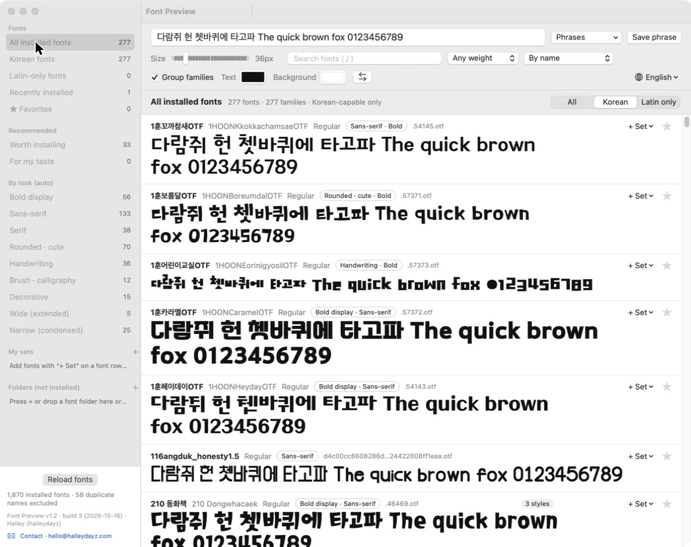
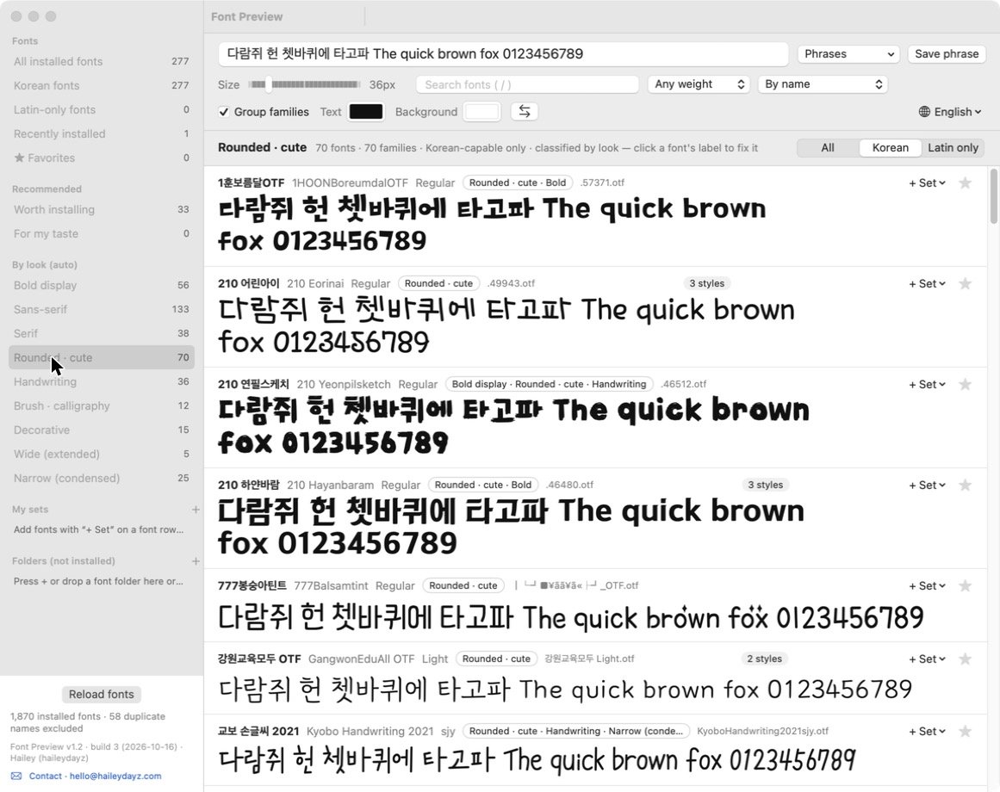
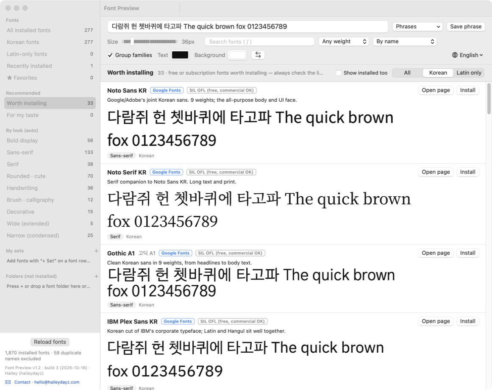
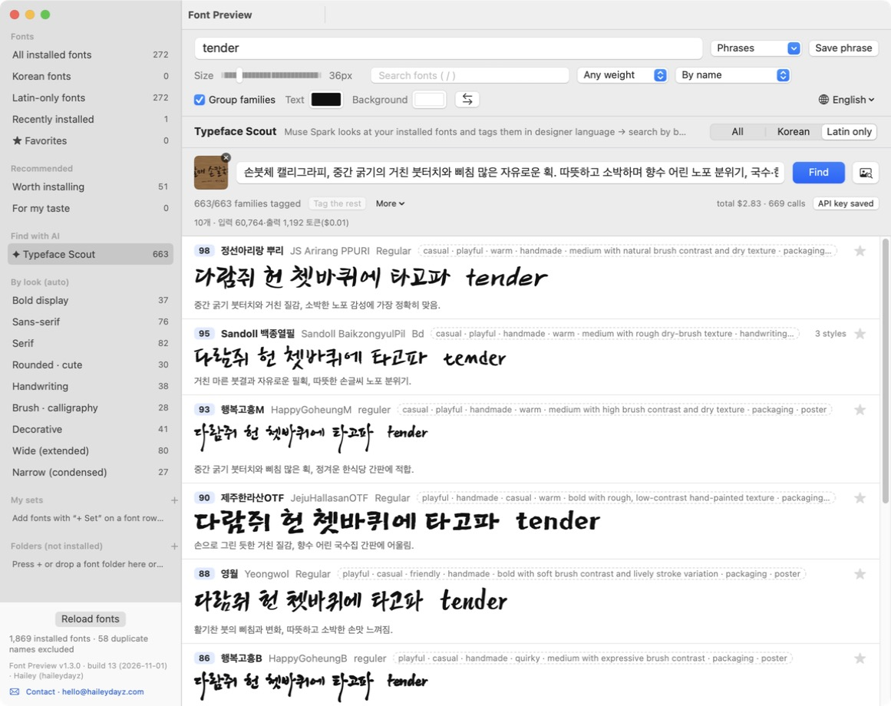
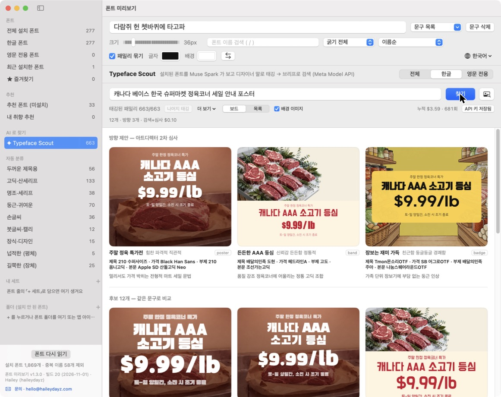
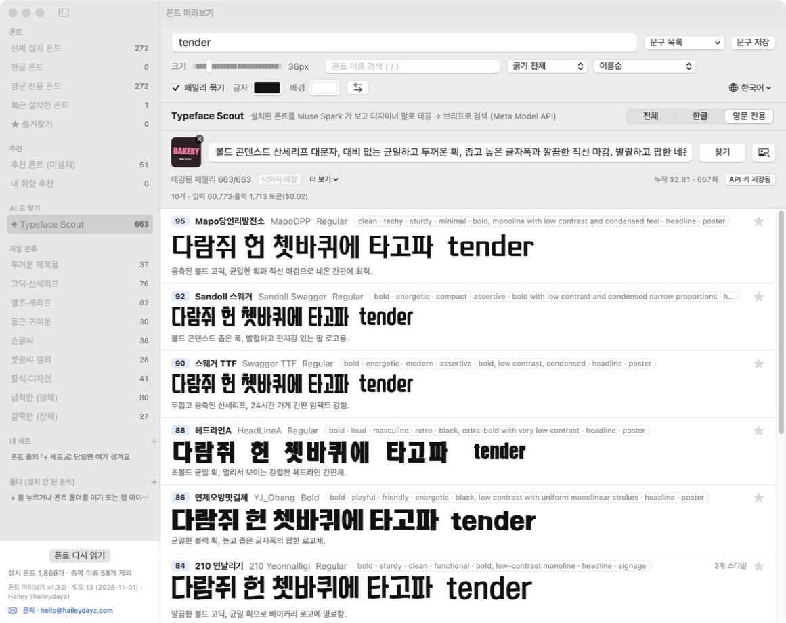

# Font Preview for Mac (폰트 미리보기)

A native macOS font previewer in the spirit of NexusFont on Windows: every installed font (Adobe Fonts included) rendered with the same sample text in one window, **sorted by how fonts look** — bold display, sans, serif, rounded, handwriting, brush, decorative, wide, condensed — plus personal sets, folder previews for fonts you haven't installed, and a curated "worth installing" tab with live previews and one-click install for open-licensed fonts. **v1.3 adds Typeface Scout**: describe the font you need in plain words, or drop a photo of a sign, and an AI that has looked at every font on your Mac ranks the matches.

**English and Korean UI** — follows your system language, switchable any time from the 🌐 menu (top right) or Help → Language.

## Install

1. Download `FontPreview-<version>.zip` from [Releases](https://github.com/haileydaysincanada-maker/font-preview-mac/releases), unzip, move the app to Applications.
2. First launch (the app is ad-hoc signed but not notarized, so macOS warns once):
   - **macOS 15 Sequoia or later**: double-click, close the warning, then open **System Settings → Privacy & Security**, scroll down and click **Open Anyway** (the button stays for about an hour), enter your password, and click **Open**.
   - **macOS 13–14**: **right-click → Open**, then **Open**.
   - 처음 열 때(한국어): macOS 15 이상은 시스템 설정 → 개인정보 보호 및 보안 → 「그래도 열기」, macOS 13·14는 우클릭 → 「열기」. 한 번만 하면 다음부터는 그냥 열린다.
3. macOS 13 Ventura or later. Universal binary (Apple Silicon + Intel).

Or build it yourself with only the Command Line Tools (no Xcode): `native/build.sh` → `폰트 미리보기.app` in about a minute.

## How to use

- **Sample text** at the top; the **Phrases** menu keeps your favorites; **Size** slider, **Text / Background** colors, **Group families** (one row per family, expand with "N styles").
- **Sidebar → Fonts**: all installed, Korean, Latin-only, recently installed (30 days), ★ favorites.
- **Sidebar → By look (auto)**: fonts are classified by rendering a few glyphs and measuring stroke width, serif feet, corner roundness, baseline wobble and aspect ratio (name hints help too). Click a font's label to fix a wrong guess — it is remembered. Brush vs pen handwriting is the weakest guess; fix those by hand.
- **All / Korean / Latin only** toggle (header right) filters whatever you are looking at; fonts without Korean glyphs always show the Latin part of your sample.

- **My sets**: "+ Set" on any font row; rename or delete from the sidebar context menu.
- **Folders (not installed)**: press +, drop a folder on the sidebar or the app icon, or ⌘O. Fonts are registered for this app only — nothing is installed.
- **Recommended → Worth installing**: curated Google Fonts / Pretendard / SUIT / Adobe Fonts plus **every free Korean font listed on Noonnu (noonnu.cc, ~1,200)**, each with source, license (Noonnu fonts show which of the 7 uses are allowed), a **live preview in your sample text** (webfont fetched on demand, nothing installed) and an **Install** button for open-licensed Google/GitHub fonts. Noonnu fonts open the distributor's download page or the Noonnu page. Older Noonnu fonts (woff) are decoded in-app and rendered live; newer ones (woff2) are drawn by a hidden web view as an image, so the glyphs are always the real ones. **Refresh Noonnu** (header) pulls the latest list so new releases show up without an app update.
- **Recommended → For my taste**: star or set at least 3 fonts and this list ranks the catalog by similarity to what you like.

Click a font name to copy its PostScript name, click the file name to copy its path. `/` focuses search.

## Typeface Scout — find a font by brief or by photo (v1.3)

Designers don't think in font names. They think *"warm hand-lettered Korean for a bakery logo"* or *"the condensed uppercase on that neon sign"*. Typeface Scout turns your installed library into something you can ask that way.

**How it works**

1. **Tag my fonts** (once). For every installed family the app renders one sample image — a Latin pangram line and, if the font has Hangul, a Korean line — and sends it to **Muse Spark 1.3** (Meta Model API) with a typographer's brief. The model answers in designer vocabulary: mood, structural class (geometric sans, didone, slab, brush, monoline handwriting…), era, weight feel, best uses, a one-line personality and where it would look wrong. Tags are cached on your Mac, so this runs once per font.
2. **Write a brief and press Find** (or click one of the example briefs). The whole tagged catalog goes to Muse Spark as a stable system prompt (so it is prompt-cached) and the model returns up to 12 ranked picks, each with a fit score and a one-line *why* in the language of your brief. Results open as a **board**: every pick is a small poster tile. The model first reads the *genre* of your brief and writes fictional sample copy shaped the way that genre really works — a sale poster leads with the product and the price, a logo with the name, a book cover with the title — and picks a palette per font; the app renders that copy with the *real* installed font, the same words on every tile so fonts compare fairly. Then a second pass: the candidates are rendered in the actual copy and shown to Muse Spark again as an **art director** — legibility first for anything read at a glance (prices, digits, product names), heavy is fine but decorative is not, rough textured headlines welcome, no 2000s free-font clichés unless asked. It re-ranks the tiles (with a legibility score, a role — headline / price / sub / body / avoid — and the direction each font belongs to, whose background and layout the tile then reuses) and proposes **two or three directions**, each a mini mock-up with separate fonts for headline, price, sub and body, in a different layout (overlay, split, band, badge, frame, poster) over a background that **Muse Image** paints for the brief ($0.01 each, optional). The lettering is never generated: images are backgrounds only, and every letter is your font. Click a tile for your own sample text and everything the model saw; switch to **List** for the classic rows. **👍 / 👎 on any tile teaches Scout your taste**: thumbs are stored on your Mac and fed to the next search and review as liked / disliked fonts with their qualities — disliked fonts drop out, and the picks drift toward what you'd choose.

3. **Or find from a photo.** Drop a photo of a sign, poster, package or book cover onto the window (or use the 📷 menu, File → *Find from Photo…* ⌘⇧O, or *Find from Clipboard Image* ⌘⇧V). Muse Spark describes the lettering as a brief — structure first, then weight, width, mood, era — fills the brief field and searches immediately. The thumbnail stays next to the brief; hover it for what the model noticed.

**Fonts you don't have yet**: *More → Tag Noonnu fonts* tags the ~400 CoreText-loadable Noonnu fonts you haven't installed from their thumbnails (≈$0.003 each, about US$1.3 for all, no downloads). They then join the search catalog as *not installed* and show up in results and directions with a «Not installed · Noonnu» badge and download / Noonnu buttons — the font file is fetched only when one is picked, so the tiles still render the real glyphs.

No API key? Scout still works offline with a plain keyword match over the cached tags (clearly labelled as local).

**Cost and setup**

- Create a key at dev.meta.ai → API keys and paste it once via the **API key** button. It is stored in your Mac's Keychain only and sent only to Meta's API. The app uses the standard `muse-spark-1.3` endpoint, not the "contributor" variant, so your images are not used for training.
- Measured on a library of 663 families: tagging everything took about 10 minutes and **US$3.13** (≈$0.005 per family). A search is ≈$0.02–0.08 (catalog is prompt-cached after the first call) + ≈$0.07 for the art-director review + $0.03 for three backgrounds, so **about $0.12–0.18 per brief**; a photo brief ≈$0.005. The running total is shown in the Scout header.

**What leaves your Mac**: only the rendered sample images (black pangram text on white), the text catalog of tags, your brief, the short scene prompts for the optional backgrounds, and photos you explicitly drop. Lettering is never generated — tiles and directions are drawn locally with your fonts over the background, so the letterforms are always the real ones. Font files never leave the machine. Tags live in `~/Library/Application Support/fontviewer/scout_tags_v1.json`; *More → Clear tags* removes them.

Built during the Meta Global AI Developer Hackathon 2026.

## Data & privacy

Everything stays on your Mac: `~/Library/Application Support/fontviewer/` (favorites, sets, phrases, manual classifications, registered folders, analysis cache) and `~/Library/Caches/fontviewer/preview/` (preview files). Network is used only when you open the Recommended tab (preview downloads from Google Fonts / jsDelivr), press Install (GitHub), or use Typeface Scout (Meta Model API, see above).

## License

MIT. The font catalog only links to each font's own distributor and license — no font files are bundled.

---

# 폰트 미리보기 — 맥 설치 폰트 미리보기, NexusFont 맥 대체

윈도우 회사 컴퓨터의 「폰트 미리보기 v1.1」과 같은 구도의 **맥 네이티브 앱**(SwiftUI). 왼쪽 = 폰트 / 자동 분류 / 내 세트 / 폴더, 위 = 문구·크기·검색·굵기·정렬·패밀리 묶기·글자/배경 색, 아래 = 폰트 줄(이름·스타일·분류 표시·파일명·+세트·★) + 미리보기.
**어도비 폰트(Creative Cloud 로 활성화한 Adobe Fonts)도 그대로 보인다** — 맥에 등록된 폰트는 전부 CoreText 로 읽는다(2026-10-15 실측 1,870벌 중 Adobe 835벌).

## 실행

| 하고 싶은 것 | 방법 |
|---|---|
| 열기 | **`폰트 미리보기.app`** 더블클릭 (응용 프로그램 폴더나 Dock 으로 옮겨도 됨 — 단독 실행 파일) |
| 설치 **안 한** 폰트 폴더 보기 | 사이드바 「폴더」의 **+** / 폴더를 사이드바에 드롭 / 폴더를 앱 아이콘에 드롭 / ⌘O. 설치되지 않고 이 앱 안에서만 보인다. 등록은 기억되고, 우클릭 → 「목록에서 빼기」 |
| 폰트를 새로 설치했는데 안 보임 | 사이드바 맨 아래 **「폰트 다시 읽기」** 또는 ⌘R (0.2초) |
| 다시 빌드 | `native/build.sh` (Xcode 없이 커맨드라인 툴만으로, 20~40초). 빌드마다 빌드 번호가 1 올라가고(`native/BUILD_NUMBER`), 버전·제작자는 build.sh 맨 위 `VERSION`·`AUTHOR` |

첫 실행 때 생김새 분석이 뒤에서 10초쯤 돌고(`~/Library/Application Support/fontviewer/profiles_native_v1.json` 에 저장) 그다음부턴 바로 뜬다.

## 화면

- **폰트**: 전체 설치 폰트 / 한글 폰트 / 영문 전용 폰트 / 최근 설치한 폰트(30일) / ★ 즐겨찾기
- **자동 분류**(생김새로 자동, 한 폰트가 여러 곳에 들어갈 수 있음): 두꺼운 제목용 · 고딕·산세리프 · 명조·세리프 · 둥근·귀여운 · 손글씨 · 붓글씨·캘리 · 장식·디자인 · 넙적한(평체) · 길쭉한(장체)
  - 틀린 건 폰트 줄의 **분류 표시(칩)를 클릭** → 분류·굵기 토글. 손으로 고친 건 점선 테두리, 「자동으로 되돌리기」로 복원.
- **내 세트**: 폰트 줄의 「+ 세트」로 담기(여러 세트 가능), 사이드바 + 로 빈 세트 만들기, 우클릭 → 이름 바꾸기 / 세트 삭제(폰트는 안 지워짐)
- **언어 토글**(분류 헤더 줄 오른쪽, 전체 / 한글 / 영문 전용): 지금 보고 있는 분류·세트·폴더 위에 겹쳐 걸린다. 그리고 토글과 무관하게 **한글이 없는 폰트는 항상 영문 문구만** 그린다(「영문 전용 폰트」 그룹 포함). 손글씨·붓글씨처럼 영문 전용이 섞인 분류에서 「한글」을 누르면 한글 되는 것만 남는다. 「영문 전용」일 땐 미리보기 문구도 영문·숫자만 그린다. 첫 실행 분석이 끝나기 전엔 아직 못 잰 폰트는 안 보인다.
- **추천**(사이드바 「추천」): ① **추천 폰트 (미설치)** — 큐레이션(Google·프리텐다드·SUIT·Adobe) + **눈누(noonnu.cc) 등록 무료 한글 폰트 전부(약 1,200개)** 중 아직 안 깔린 것. 눈누 폰트는 허용 용도 N/7·제작사·굵기 수가 붙고 「다운로드 페이지」·「눈누 페이지」로 간다. 미리보기 = 구형(woff)은 앱이 직접 풀어 CoreText 로, 신형(woff2)은 숨은 웹뷰가 그린 이미지로(글자는 진짜 폰트). 헤더의 「눈누 새로고침」이 최신 목록을 받아 새 폰트를 추가한다(`native/build_noonnu.py` 가 번들 데이터 정본). 이름·설명·분류 태그·라이선스·출처가 붙어 있고, **Google Fonts·GitHub 배포분(프리텐다드·SUIT)은 「설치」 버튼 하나로** `~/Library/Fonts/<이름>/` 에 들어가 바로 목록에 뜬다. 눈누·배포처 폰트는 「페이지 열기」로 가서 라이선스 확인 후 직접, Adobe Fonts 는 「활성화 페이지」(CC 구독이면 무료). ② **내 취향 추천** — ★·세트에 담은 폰트 3개 이상이면 그 폰트들의 분류 태그 빈도로 점수를 매겨 같은 결의 미설치 폰트를 순서대로. 각 줄에 «별·세트에 담은 N개 중 붓글씨 3개와 같은 결» 식의 이유 표시. 「설치된 것도 보기」 체크로 전체 카탈로그 열람. 언어 토글·굵기·검색이 그대로 걸린다.
  - **미리보기**: Google Fonts·프리텐다드·SUIT 는 설치 없이 미리보기 파일을 받아(`~/Library/Caches/fontviewer/preview/`) 같은 문구·크기·색으로 그린다. Google 은 **지금 문구에 든 글자만 담은 서브셋**을 받으므로 문구를 바꾸면 0.6초 뒤 다시 받는다(수십 KB). 눈누·Adobe 는 파일을 직접 주지 않아 흐린 자리표 + 「페이지 열기」.
  - 카탈로그 정본 = `native/catalog_src.py`(고르는 곳) → `native/build_catalog.py`(GitHub API·배포처 페이지에 전부 접속해 검증, 안 열리면 제외) → `native/catalog.json`(앱에 번들). 폰트를 더 넣으려면 src 에 한 줄 추가 후 `python3 build_catalog.py && ./build.sh`. `~/Library/Application Support/fontviewer/catalog.json` 을 두면 그게 우선.
- **문구**: 큰 입력칸에 직접 쓰기, 「문구 목록」에서 고르기, 「문구 저장/삭제」, 「폰트 이름으로」 = 각 폰트가 자기 이름을 그림
- 크기 9~180px · 검색(`/` 키로 포커스, 띄어쓰기 AND, 패밀리·영문명·스타일·PostScript·파일명 대상) · 굵기 필터 · 정렬(이름/최근 설치/얇은→굵은/즐겨찾기 먼저) · 패밀리 묶기(대표 1개, 「N개 스타일」로 펼침) · 글자/배경 색 + ⇄
- 폰트 이름 클릭 = PostScript 이름 복사, 파일명 클릭 = 경로 복사. 미리보기 글자는 드래그로 선택·복사 가능.

## Typeface Scout — 말로·사진으로 폰트 찾기 (v1.3)

디자이너는 폰트 이름이 아니라 «베이커리 로고용 따뜻한 손글씨, 한글·영문 둘 다» 나 «저 네온 간판의 콘덴스드 대문자» 처럼 생각한다. Typeface Scout 는 내 맥의 설치 폰트를 그렇게 물어볼 수 있게 만든다. 사이드바 「AI 로 찾기 → ✦ Typeface Scout」.

1. **「내 폰트 태깅」**(한 번만) — 패밀리마다 샘플 1장(영문 팬그램 한 줄 + 한글이 있으면 한글 한 줄)을 그려 **Muse Spark 1.3**(Meta Model API)에 보낸다. 모델이 디자이너 어휘로 답한다: 분위기·구조(geometric sans·didone·slab·brush·monoline handwriting…)·시대·굵기감·어울리는 곳·한 줄 성격·피할 곳. 태그는 맥에 저장되니 폰트당 한 번이다.
2. **브리프를 쓰고 「찾기」**(빈 화면의 예시 칩을 눌러도 됨) — 태깅된 카탈로그 전체가 시스템 프롬프트로 가고(안정 프리픽스라 프롬프트 캐시 적중), 최대 12개를 적합도 점수 + 브리프 언어로 쓴 한 줄 이유와 함께 돌려준다. 결과는 **보드**로 열린다: 후보마다 작은 포스터 타일. 모델이 브리프의 *장르*를 먼저 읽고 그 장르답게 가상의 샘플 카피를 짠다 — 세일 포스터면 상품·가격이 제일 크게, 로고면 이름, 책 표지면 제목 — 폰트별 팔레트도 고르고, 앱이 그 카피를 **진짜 설치 폰트**로 그린다(모든 타일에 같은 문구라 공정 비교). 그다음 2차로, 후보들을 실제 카피로 렌더해 Muse Spark 에 **아트디렉터** 역할로 다시 보여준다 — 한눈에 읽혀야 하는 글(가격·숫자·상품명)은 가독성이 먼저, 두꺼운 건 괜찮지만 장식은 안 됨, 거친 질감 제목은 환영, 레트로를 요구하지 않으면 2000년대 무료 폰트 클리셰 회피. 타일을 재순위(가독성 ●●●○○ + 역할: 제목·가격·부제·본문·비추천 + 소속 방향 — 타일은 그 방향의 배경·레이아웃을 그대로 씀)하고 **방향 2~3개**를 제안하는데, 각 방향은 제목·가격·부제·본문 폰트가 따로인 미니 목업이고 레이아웃(overlay·split·band·badge·frame·poster)이 다르며 배경은 **Muse Image**가 브리프에 맞춰 그린 사진·일러스트(장당 $0.01, 「배경 이미지」 체크로 끄기). 글자는 절대 생성하지 않는다 — 이미지는 배경뿐, 글자는 전부 내 폰트. 타일 클릭 = 내 문구 미리보기 + 모델이 본 태그 전체, 「목록」으로 바꾸면 예전식 줄 보기. **타일의 👍/👎 가 취향을 가르친다** — 맥에만 저장되고 다음 검색·심사에 «좋아한/거른 폰트와 그 특징»으로 들어가서, 👎 는 빠지고 추천이 점점 내가 고를 쪽으로 기운다.

3. **사진으로 찾기** — 간판·포스터·패키지·책 표지 사진을 창에 끌어다 놓거나, 📷 메뉴 / 파일 → 「사진으로 찾기…」⌘⇧O / 「클립보드 이미지로 찾기」⌘⇧V. Muse Spark 가 글자를 구조→굵기·폭→분위기·시대 순으로 브리프로 써서 칸을 채우고 바로 검색한다. 썸네일은 브리프 옆에 남고(툴팁 = 모델이 본 것), × 로 지운다.

**아직 안 깐 폰트**: 「더 보기 → 눈누 폰트 태깅」이 CoreText 로 그릴 수 있는 미설치 눈누 폰트 약 400개를 썸네일로 태깅한다(개당 ≈$0.003, 전체 약 US$1.3, 파일 안 받음). 그 뒤엔 검색 카탈로그에 «미설치»로 들어가 결과·방향 카드에 «미설치 · 눈누» 배지와 ↓다운로드·눈누 버튼을 달고 섞여 나온다 — 뽑힌 폰트만 그때 웹폰트를 받아 진짜 글자로 그린다.

API 키가 없으면 저장된 태그로 로컬 키워드 매칭만 한다(「로컬」이라고 표시).

- **키·요금**: dev.meta.ai → API keys 에서 만들어 「API 키」 버튼에 한 번 붙여넣기. 맥 키체인에만 저장되고 Meta API 로만 간다. 표준 `muse-spark-1.3` 만 쓰고 «contributor» 변형은 안 쓴다(내 이미지가 학습에 안 들어감). 실측(663 패밀리): 전수 태깅 10분·**US$3.13**(패밀리당 ≈$0.005), 검색 ≈$0.02~0.08 + 아트디렉터 심사 ≈$0.07 + 배경 3장 $0.03 ≈ **회당 $0.12~0.18**, 사진으로 찾기 1장 ≈$0.005. 누적은 Scout 헤더에 표시.
- **나가는 것**: 샘플 렌더 이미지(흰 배경 검정 글자)·태그 텍스트 카탈로그·브리프·배경 이미지용 짧은 장면 설명·직접 넣은 사진뿐. 폰트 파일은 안 나간다. 글자는 절대 생성하지 않는다 — 타일·방향 카드의 글자는 앱이 배경 위에 내 폰트로 직접 그린 것이라 가짜일 수 없다. 태그 = `~/Library/Application Support/fontviewer/scout_tags_v1.json`, 「더 보기 → 태그 지우기」로 삭제.
- 개발용: `MODEL_API_KEY` 환경변수가 있으면 키체인보다 우선 · `SCOUT_TEST_PHOTO=<이미지>` 로 실행하면 그 사진으로 바로 찾기(UI 자동 검증용).

## 자동 분류가 보는 것 (왜 틀릴 수 있나)

CoreGraphics 비트맵에 글자를 그려 잰다 — 굵기 = `ㅣ`(또는 `l`) 획 두께, 명조 = 획 끝 발(부리) 비율·가로/세로 획 대비, 둥근 = `ㅡ`(또는 `-`) 모서리 채움, 손글씨 = `가나다라마…` 높이 들쭉날쭉함·직선 비율, 붓글씨 = 이름 힌트(Brush·붓·캘리) 또는 심한 흘림, 장평 = `한`(또는 `H`) 가로세로비. 이름에 Round·Bold·손글씨·Condensed 같은 힌트가 있으면 같이 쓴다. **붓글씨 vs 펜글씨**는 픽셀로는 잘 안 갈려서 이름 힌트가 없으면 손글씨로 들어간다 — 분류 칩으로 고치면 된다.

## 데이터 위치

`~/Library/Application Support/fontviewer/` — `user.json`(즐겨찾기·세트·문구·수동 분류·화면 상태, 웹판과 같은 파일) · `folders.json`(등록 폴더) · `profiles_native_v1.json`(분석 결과) · `scout_tags_v1.json`(Typeface Scout 태그·누적 비용). 지우면 초기화. API 키는 키체인(`com.haileydayz.fontviewer.scout`).

## 한계

- 숨김 시스템 폰트(`.SF …`)는 안 보인다(앱에서도 못 씀). 같은 PostScript 이름이 여러 파일이면 1개만(「중복 이름 N개 제외」로 표시).
- 폴더의 `.woff2` 는 이름을 못 읽어 파일명으로. 분류는 100% 가 아니다(위 참조).

## 파일

- `폰트 미리보기.app` — 네이티브 앱(빌드 산출물). `native/Sources/*.swift` + `native/build.sh` + `native/AppIcon.icns` 가 소스.
- `web/` — 이전 HTML·로컬서버 판(`fontviewer.py`, `폰트뷰어.command`, `폰트뷰어.app`). 같은 `user.json` 을 쓴다. 브라우저로 보고 싶을 때만.
